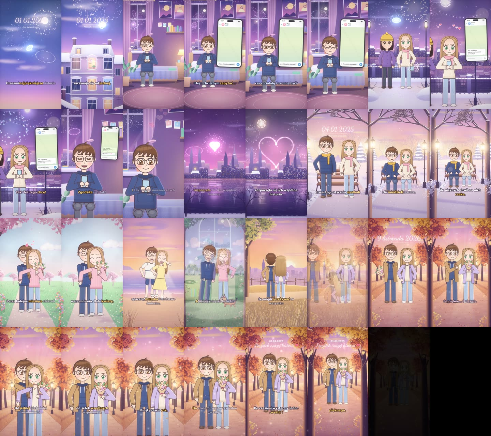

# project1 — «Denis i Maja»

Романтический 2D-мультфильм для TikTok / Reels на польском языке.

| | |
|---|---|
| Готовое видео | [`out/denis-maja-v1.mp4`](out/denis-maja-v1.mp4) |
| Формат | 1080×1920 (9:16), 30 fps, H.264 + AAC 256 kbps |
| Длительность | 61,05 с (1832 кадра) |
| Звук | польская озвучка ElevenLabs, оригинальная музыка, 19 SFX; −14 LUFS, true peak −1,3 dBTP |
| Сделано на основе | скил `.claude/skills/vizavi-story-studio` (лежит отдельно, этот проект использует его как библиотеку) |



Это **не 3D**. Всё в фильме нарисовано кодом на HTML Canvas 2D: персонажи, фоны, телефон, титры и эффекты. В проекте нет ни одной готовой картинки, спрайта или 3D-модели. Three.js в скиле есть, но здесь он не понадобился.

---

## Структура папки

```
project1/
├── README.md               ← этот файл
├── package.json            ← зависимости и команды (npm run …)
├── remotion.config.ts      ← рендер через программный WebGL (swangle), GPU нет
├── lines.json              ← сценарий: все реплики, голоса и их настройки
├── timeline.json           ← «замороженный» таймлайн (читабельная копия)
├── src/                    ← видео (Remotion + Canvas 2D)
│   ├── index.ts            ← точка входа + ускорение рендера (см. ниже)
│   ├── Root.tsx            ← композиции: Film, CharSheet (лист персонажей), BgPreview (просмотр фона)
│   ├── Film.tsx            ← покадровый композитор: сцены, переходы, эффекты, титры, звук
│   ├── shots.ts            ← постановка всех сцен: камера, позы, эмоции, реквизит
│   ├── timeline.json       ← тот же таймлайн, который импортирует код
│   ├── chars/              ← персонажи: rig.ts (риг), cast.ts (внешность и одежда), actor.ts (свет),
│   │                         lipsync.ts (движение губ), dog.ts (йоркширский терьер), CharSheet.tsx
│   ├── bg/                 ← 13 фонов: night-*.ts (ночные), day-*.ts (дневные), *-kit.ts (кисти и утилиты)
│   ├── ui/                 ← phone.ts (чат в телефоне), text.ts (субтитры, даты, финальные титры)
│   ├── props.ts            ← букет, планшет, попкорн, плед, ноты, брызги
│   ├── fx.ts               ← bloom, виньетка, зерно, блики, сердечки, искры
│   └── lib/                ← util.ts (математика, easing, PRNG, шум), fonts.ts, types.ts
├── voice/                  ← озвучка: <id>.mp3 + <id>.json (таймстемпы каждой буквы от ElevenLabs)
├── audio/
│   ├── score.py            ← оригинальная музыка (синтез в numpy) → score.wav + score_cues.json
│   ├── gen-sfx.mjs         ← генерация звуковых эффектов через ElevenLabs → sfx/*.mp3 (+ ledger.json с расходом)
│   ├── mix.py              ← финальный микс → public/audio/mix.wav
│   └── inspect_audio.py, analyze_sfx.py, probe_m4.py  ← проверки звука
├── public/audio/mix.wav    ← готовая звуковая дорожка, которую подкладывает Remotion
├── tools/                  ← build-timeline.mjs, gen-lines.mjs (озвучка), audition/design/library/probe (подбор голосов),
│                             score.py и analyze_previews.py (оценка польского произношения), stills.mjs (стоп-кадры)
├── auditions/              ← пробы голосов Дениса, Маи и рассказчика + таблица оценок
├── docs/storyboard.jpg     ← раскадровка для этого README
└── out/
    ├── denis-maja-v1.mp4   ← ГОТОВЫЙ ФИЛЬМ
    └── qa/                 ← отчёт автоматической проверки и контактные листы кадров
```

В git не попадают файлы, которые пересобираются или не наши (см. `.gitignore`): `node_modules/`, `audio/stems/` (51 МБ, создаёт `npm run mix`), `auditions/previews/` (превью чужих голосов из библиотеки ElevenLabs) и `out/qa/perframe.npz`.

---

## Как пересобрать

Нужны Node 20+, Python 3 с `numpy scipy soundfile` (полный список в `../.claude/skills/vizavi-story-studio/requirements-audio.txt`), `ffmpeg` с фильтром `rubberband`.

```bash
cd project1
npm install

npm run timeline     # таймлайн из длительностей и таймстемпов озвучки
npm run music        # музыка → audio/score.wav
npm run mix          # микс → public/audio/mix.wav
npm run render       # видео → out/denis-maja-v1.mp4 (около 3 минут на 4 ядрах без GPU)
npm run qa           # проверка готового файла → out/qa/report.md
npm run studio       # интерактивный просмотр в браузере
```

Отдельные куски можно смотреть так:

```bash
npx remotion render src/index.ts Film out/test.mp4 --public-dir public --frames=1500-1560
npx remotion still  src/index.ts CharSheet out/cast.png                          # лист персонажей
npx remotion still  src/index.ts BgPreview out/bg.png --props='{"bg":"park","t":2}' # один фон
```

Озвучку и SFX заново генерировать не нужно, они уже лежат в `voice/` и `audio/sfx/`. Если всё-таки нужно (`node tools/gen-lines.mjs`, `node audio/gen-sfx.mjs`), используется ключ ElevenLabs. Его читает `../.claude/skills/vizavi-story-studio/scripts/el-api.mjs` из `.env` скила или переменной `ELEVENLABS_API_KEY`. Ключ в git не хранится.

Пересборка детерминирована: `npm run timeline`, `npm run music` и `npm run mix` из этой папки дают побайтно те же `timeline.json`, `score.wav` и `mix.wav`, что лежат в репозитории.

---

## Как это сделано

### 1. Главный принцип: всё подчиняется таймлайну озвучки

Сначала записывается голос, потом под него собирается картинка, а не наоборот. `tools/build-timeline.mjs` берёт реальные длительности mp3 и таймстемпы каждой буквы от ElevenLabs и раскладывает по ним сцены, события («начал печатать», «удалил», «вдох», «отправил», «вручил цветы», «объятие», «поцелуй»…) и звуковые эффекты. Результат — `timeline.json`, и его читают **все** части проекта:

- видео (`shots.ts`), чтобы знать, когда что происходит;
- движение губ и субтитры (по буквам и словам);
- музыка (`score.py` ставит аккорды и акценты на события);
- микс (`mix.py` кладёт голоса и SFX на нужные секунды).

Поэтому если поменять реплику, достаточно перезапустить `timeline → music → mix → render`, и всё синхронно сдвинется.

Монтаж воспоминаний режется прямо по словам рассказчика: кадр с цветами начинается на «kwiaty», кино на «filmy», море на «wakacje», собака на «śmiechu».

| Время | Сцена | Что происходит |
|---|---|---|
| 0,0–4,7 | `sky` | Новогоднее небо, фейерверки, карточка «01.01.2025 · Noc sylwestrowa», камера наезжает на окно Дениса |
| 4,7–12,1 | `room` | Денис печатает признание, стирает, набирает заново, глубоко вдыхает и жмёт «отправить» |
| 12,1–17,8 | `maja` | Мая с подругой у реки, телефон вибрирует, удивление → улыбка → «Tak! Też tego chcę!» |
| 17,8–21,3 | `denis_reads` | Денис читает ответ: «Zgodziła się! Tak!», сердечки |
| 21,3–25,3 | `city` | Панорама города, большой фейерверк-сердце |
| 25,3–31,8 | `park` | 04.01.2025, первая встреча на скамейке в зимнем парке |
| 31,8–42,6 | `memories` | Шесть воспоминаний: цветы → кино на диване → море → собака → танцы → закат |
| 42,6–61,0 | `finale` | 9 listopada 2026, осенняя аллея: букет, «Są piękne… Dziękuję.», объятие, поцелуй, финальные титры |

### 2. Персонажи: процедурный 2D-риг (`src/chars/`)

Каждый персонаж описан **одним** объектом в `cast.ts`, поэтому в любом кадре он выглядит одинаково:

- **Look** — внешность: цвет кожи, волос, радужки, линии контура (тёплый тёмный, никогда не чёрный), причёска, очки, пропорции. Денис: каштановые волосы, карие глаза, очки. Мая: зелёные глаза, длинные светло-каштановые волосы на прямой пробор, без чёлки и украшений.
- **Outfit** — одежда по сезону: зимняя, повседневная, летняя, осенняя. Лицо и причёска при этом не меняются.
- **Pose** — всё, что меняется от кадра к кадру: положение, масштаб, сидит или стоит, фаза ходьбы или бега, прыжок, наклон, поворот и наклон головы, направление взгляда, эмоции (`smile`, `joy`, `surprise`, `worry`, `shy`, `blush`, `sparkle`), открытость рта и гласная, цели для рук, предмет в руках, вид со спины, привставание на носочки.

Как рисуется фигура (`rig.ts`, функция `drawPerson`):

- Начало координат — центр таза, рост около 900 единиц. Тело собирается из кривых Безье с заливкой и контуром.
- **Руки** работают на двухзвенной инверсной кинематике (`ik`): задаёшь точку, куда положить кисть, а локоть сгибается сам. Так руки держат телефон, букет и друг друга. Кисти — мультяшные «варежки» пяти типов: open, fist, hold, wave, point.
- **Глаза**: белок, радужка с градиентом и тёмным ободком, два блика, тень от верхнего века, линия ресниц. Есть «счастливые» закрытые глаза ^ ^ и «искры» в глазах. **Моргание** идёт по собственному ритму у каждого персонажа, поэтому Денис и Мая моргают не синхронно.
- **Волосы** состоят из двух слоёв: задняя масса рисуется за телом, передние пряди перед лицом. Прядь мягко покачивается от времени и движения. У Дениса растрёпанная чёлка набок с вихрами, у Маи две «шторки» вдоль лица.
- **Рот** — по эмоции и по текущей гласной (a / e / o). **Брови**, **румянец** и **очки** с бликом на стёклах рисуются отдельными функциями.
- **Ноги**: стоя, при ходьбе и беге (фаза задаётся углом), сидя (бёдра сокращены в перспективе к камере).
- **Подруга** Маи специально сделана с другим силуэтом (тёмное каре, шапка, фиолетовое пальто), чтобы её не путали с Маей. **Йоркширский терьер** нарисован отдельно в `dog.ts`.

**Свет на персонажах** (`actor.ts`, `litLayer`): персонажи рисуются в отдельный слой, на него сверху ложится градиент — тёплый «ключевой» свет со стороны лампы или солнца и холодный «заполняющий» с другой (`source-atop`). Затем делается **контровой свет**: слой копируется, сдвигается на 9 px в сторону от света, вычитается из оригинала (`destination-out`), оставшийся край заливается цветом контра и добавляется режимом `lighter`. Под ногами рисуется мягкая контактная тень. Поэтому один и тот же риг выглядит «своим» и в ночной комнате, и на закатном пляже.

**Липсинк** (`lipsync.ts`): ElevenLabs возвращает время каждой буквы. Для текущего кадра берётся буква, которая сейчас звучит, и превращается в открытость рта и форму: `a` широко, `o/u/ó/ą` округло, `e/i/y/ę` узко, `m/b/p` рот закрыт, остальные согласные приоткрыты. Это работает с польскими буквами напрямую.

### 3. Фоны (`src/bg/`)

13 фонов, каждый — функция, которая рисует сцену кодом: `sky`, `room`, `maja`, `city`, `park`, `flowers`, `film`, `sea`, `dog`, `dance`, `everyday`, `finale`. Приёмы из «наборов кистей» `night-kit.ts` и `day-kit.ts`:

- **Запекание слоёв** (`bake`, `worldLayer`). Всё статичное (дома, деревья, мебель, небо) рисуется **один раз** в offscreen-холст, а дальше каждый кадр только копируется. Анимируются лишь живые элементы.
- **«Живописность»**: `wash` кладёт крупные мягкие цветовые пятна (неровность, как у краски), `grain` — бумажное зерно, `soft`/`blurred` дают глубину резкости для дальних планов.
- **Небо и природа**: градиентное небо, солнце с гало, гряды холмов на шуме, перистые и кучевые облака, листва из сотен «мазков» с подсветкой со стороны солнца, качающиеся деревья и трава, лепестки, листопад, бабочки, чайки.
- **Фейерверки** детерминированные: `burstSchedule` по сиду строит расписание залпов, каждый залп — частицы со свечением, гравитацией и затуханием. Они же подсвечивают небо и комнату (`fireworkFlash`) и отражаются в реке (`reflectFireworks`).
- **Ночь**: звёзды с мерцанием, силуэт города со снежными крышами и случайно горящими окнами, падающий снег, боке, гирлянды (провис по цепной линии, лампочки мерцают), комнатные растения из нарисованных листьев с прожилками.
- **Море**: накатывающая пена, солнечная дорожка, отражения на мокром песке.
- **Камера** (`applyCam` в `shots.ts`) может двигаться и зумить. Чтобы при этом не показался край, каждый фон нарисован с запасом (`OVERSCAN`: −200…1280 × −320…2240), а камера автоматически упирается в этот запас.
- У фона есть `light` (цвета и направление света для персонажей), `anchors` (где скамейка, диван, окно) и `front` (передний план поверх персонажей, например ветки или снег).

Все случайности — через детерминированный генератор `rng(seed)` (mulberry32) и `noise1`. Каждый кадр можно отрендерить отдельно, в любом порядке, и он всегда будет одинаковым. Это важно, потому что Remotion рендерит кадры параллельно.

### 4. Телефон, титры, надписи (`src/ui/`)

- **Чат** (`phone.ts`) в стиле Telegram: шапка с аватаром «M» и статусом, пузыри сообщений, время, сердечко-реакция, поле ввода с курсором. Текст в поле набирается **синхронно с голосом**: сколько букв Денис уже произнёс, столько и видно. Потом сообщение стирается, набирается заново, кнопка «отправить» нажимается с пружинкой, пузырь «влетает» в чат.
- **Субтитры** (`text.ts`): реплики разбиваются на короткие фразы по пунктуации (не длиннее ~26 символов, чтобы читалось на телефоне). Текущее слово подсвечивается, цвет зависит от говорящего: рассказчик белый, Денис голубоватый, Мая розоватая. Рисуются на плашке в нижней трети.
- **Шрифты**: Nunito (интерфейс, титры) и Dancing Script (даты, финал) из Google Fonts с подмножеством `latin-ext`, поэтому корректно выводятся ąćęłńóśźż и „кавычки”. Рендер ждёт загрузки всех начертаний, иначе первый кадр мог бы отрисоваться запасным шрифтом.
- **Карточки дат** («01.01.2025», «04.01.2025», «9 listopada 2026») и **финальные титры** появляются и исчезают с плавной анимацией.

### 5. Эффекты (`src/fx.ts`, `Film.tsx`)

Каждый кадр после сцены проходит «пост-обработку»:

1. **Bloom (свечение)**: кадр уменьшается в 4 раза, размывается (`blur 7px`) и добавляется обратно режимом `screen`. Светлое начинает мягко сиять.
2. **Виньетка** с лёгким фиолетовым оттенком, сгенерированная один раз.
3. **Плёночное зерно**: тайл 256×256 шума, который каждый кадр сдвигается и ложится режимом `overlay`.
4. **Light leak** в воспоминаниях: тёплое оранжево-розовое пятно режимом `screen`, будто засвет старой плёнки.
5. Переходы между сценами — **кроссфейды** (0,2–0,6 с), в начале и в конце — затемнение.

Эффекты внутри сцен: **взрыв сердечек** (`heartBurst`) при «Tak!», поцелуе и вручении цветов; **искры** (`sparkle`, `sparkleField`), **парящие частицы** (`motes`), **вспышка** (`flash`), **дуги вибрации** телефона, **ноты** в танце, **брызги** на море.

### 6. Озвучка (`voice/`, `lines.json`, `tools/`, `auditions/`)

- Платформа — ElevenLabs. На бесплатном плане польские голоса из общей библиотеки и Voice Design через API недоступны, поэтому выбор шёл среди стандартных многоязычных голосов.
- **Кастинг**: `tools/audition.mjs` озвучивает тестовую польскую фразу разными голосами (пробы в `auditions/`). `tools/score.py` прогоняет их через Whisper и считает вероятность, что это польский (как прокси «без акцента»), ошибку распознавания относительно текста (CER) и высоту голоса.
- Итог: **Денис** — Liam (`eleven_multilingual_v2`, молодой голос), **Мая** — Jessica (`eleven_v3`), **рассказчик** — George (`eleven_v3`). У v3 в тексте есть теги эмоций: `[warm]`, `[surprised]`, `[happy, excited]`, `[moved, softly]`.
- Каждая реплика сохраняется с выравниванием по буквам (`voice/<id>.json`), из него сделаны липсинк, субтитры и таймлайн.
- Рассказчик ускорен через `rubberband` без изменения высоты голоса: первая фраза в 1,1 раза, остальные в 1,18. Так фильм укладывается примерно в минуту.

### 7. Музыка (`audio/score.py`)

Музыка **полностью оригинальная**: генерация музыки в ElevenLabs требует платного плана, поэтому весь саундтрек синтезирован программно в numpy, без сэмплов. Инструменты из `templates/audio/instruments.py` скила плюс свои: «фетровое» пианино (аддитивный синтез), струнная группа, тёплый пэд, челеста и колокольчики, мягкая перкуссия для монтажа, timpani, реверберация зала свёрткой с синтетической импульсной характеристикой. Тональность ре мажор / си минор. Партитура написана **под события таймлайна**:

- небо: пэд Bm(add9) и мотив челесты F♯–E–D–A — «мотив сообщения»;
- комната: пианино пульсирует как сердцебиение и сбивается, когда Денис стирает сообщение; на «отправить» напряжение разрешается в D(add9);
- «Tak!»: яркий подъём, колокольчики, восходящее арпеджио;
- город: главная тема (пианино в октаву + челеста + струнные), на фейерверк-сердце — искры глокеншпиля;
- парк: нежное соло пианино;
- воспоминания: лёгкий грув (бочка, щелчки, шейкер, пиццикато), по аккорду на каждый эпизод, темп подогнан так, чтобы смена кадра попадала на долю;
- финал: тема возвращается на пианино, струнные растут, кульминация на финальном титре, а в самом конце челеста повторяет начальный мотив («история продолжается»).

Карта всех музыкальных событий с секундами пишется в `audio/score_cues.json`.

### 8. Звуковые эффекты и микс (`audio/`)

- **19 SFX** сгенерированы ElevenLabs Sound Effects API (`gen-sfx.mjs`): фон фейерверков, большой залп, клавиши, вибрация, «отправлено», «динь», вдох, вздох удивления, зимние и летние птицы, шаги по снегу и асфальту, волны, лай, шорох букета, поцелуй, искорки, переходы. Скрипт ведёт бюджет и пишет расход в `sfx/ledger.json` (около 500 кредитов). Смех Маи в эпизоде с собакой вырезан из её записанной реплики.
- **Микс** (`mix.py`):
  - каждая реплика нормализуется к −17 LUFS;
  - музыка **приглушается под речь** (ducking −11 дБ с плавными фронтами) и подтягивается в тихих сценах;
  - SFX ставятся по таймлайну со своей громкостью;
  - на голосе лёгкий эквалайзер и общая реверберация;
  - в конце мастер-гейн до **−14 LUFS** (норма TikTok/Instagram) и true-peak лимитер с потолком −1,3 dBTP.

  Скрипт печатает отчёт по громкости каждой дорожки и сохраняет стемы `audio/stems/{voice,music,sfx}.wav`.

### 9. Рендер (`Film.tsx`, `src/index.ts`)

- Remotion вызывает компонент `Film` для каждого кадра. Он рисует **весь кадр в один `<canvas>`**: текущую сцену (и предыдущую, если идёт кроссфейд) в буферы, потом эффекты, титры и затемнение. Звук — готовый `mix.wav`.
- **Ускорение в 7 раз.** GPU здесь нет, и Chrome по умолчанию рисовал 2D-холсты через программную эмуляцию GPU (SwiftShader). Это очень медленно: полный рендер не уложился бы и в час. В `src/index.ts` у каждого 2D-контекста включается `willReadFrequently: true`, и Chrome переходит на обычную CPU-растеризацию Skia. Тестовый кусок из 12 кадров стал рендериться за 4,5 с вместо 28 с, картинка та же (SSIM 0,99 при сравнении кадров). Весь фильм рендерится **примерно за 2 мин 45 с** на 4 ядрах.

### 10. Проверка качества

- `npm run qa` (скрипт скила `templates/scripts/short_qa.py`) проверяет размер, fps, громкость, тишину, чёрные и белые кадры, «замёрзшие» участки и резкие скачки. Отчёт лежит в `out/qa/report.md` вместе с контактными листами.
- Вручную просмотрены лист персонажей (`CharSheet`), каждый фон (`BgPreview`), раскадровка всего фильма и монтаж воспоминаний. По их итогам правились позы, волосы, композиция и титры.

---

## Известные ограничения

- Длительность **61 с**, на секунду больше желаемых 60. Чтобы уложиться ровно, рассказчику пришлось бы говорить ещё быстрее.
- В `lines.json` есть реплики, которые записаны, но **в фильм не вошли**, чтобы уложиться в минуту: `d2` «Nie, nie, nie. To głupio brzmi!», `d3` «Dobra, Denis. Wysyłam!», `m1` «Ojej… to od Denisa?», `d5`/`m3` «Cześć, Maja!» / «Cześć.». Из `m4` используется только смех. Их mp3 лежат в `voice/`. Чтобы вернуть реплику, нужно добавить её в `tools/build-timeline.mjs` (как сделано с `d1`/`m2`) и пересобрать `timeline → music → mix → render`. Фильм тогда станет длиннее.
- Голоса — стандартные многоязычные голоса ElevenLabs, говорящие по-польски, а не носители. Произношение стоит оценить на слух.
